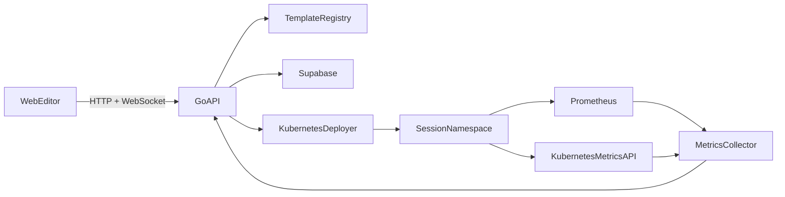

# RunCloud9

**An interactive lab for building, load-testing, and comparing software architectures/system designs.**

Pick a template, connect the components, run traffic against the result. RunCloud9 deploys your design to a real Kubernetes cluster, streams live metrics, and tears down the environment when the session ends.

You can answer questions like:

- Does adding a cache actually reduce database load, and what happens when the cache fills up?
- Do pre-built social feeds (push) outperform assembling them per request (pull), and at what write cost?
- Does scaling from one app server to three behind a load balancer improve throughput?
- What happens to a queue when the worker falls behind producers?
- How do write-through and cache-aside behave differently under the same workload?

Results are directional, not certification-grade. Sessions run on shared infrastructure with short time windows. RunCloud9 exposes the lag and estimation limits in its telemetry rather than hiding them.

## How a session works

You design a topology in the editor. The API then:

1. Validates the design against the template's rules and your account limits
2. Creates an isolated Kubernetes namespace with its own resource quota
3. Deploys the app servers, database, cache, queue, worker, and load balancer you selected
4. Seeds the database and starts a load generator
5. Streams metrics, events, and logs in real time
6. Lets you inspect database state, browse cache keys, or inject a failure
7. Saves a session summary and deletes the namespace when the session ends

## Templates

RunCloud9 ships four templates out the box.

### URL Shortener

PostgreSQL stores links. Redis caches the redirect lookups. The template lets you vary the cache strategy, eviction policy, number of app server replicas, and cache sizing independently.

Typical comparisons:

- How many database queries does the cache absorb, and how does that change when the cache is small?
- Cache-aside (the app checks cache, then DB) versus write-through or write-behind via a caching proxy
- Key eviction when memory fills up versus TTL-based expiration
- A large smart proxy in front of a small Redis instance versus the reverse

### E-Commerce

Catalog reads and checkout writes run against PostgreSQL. Redis can cache catalog pages. Adding RabbitMQ and a worker moves order processing off the request path so the app returns immediately.

Typical comparisons:

- Cached versus uncached catalog load
- Synchronous checkout (the app waits) versus async (work queued, result delivered later)
- Queue depth and worker throughput when order volume spikes

### Social Feed (Push)

When a user posts, a fan-out worker copies it into every follower's Redis timeline. Reads are fast because the feed is pre-assembled in cache. The cost is write amplification: one post becomes thousands of writes for users with large follower counts.

Typical comparisons:

- Write amplification as follower count grows
- Worker saturation and queue depth under celebrity-post traffic
- Memory and throughput tradeoffs at different cache sizes

### Social Feed (Pull)

Feeds are assembled from PostgreSQL at read time. No fan-out happens on write. This is the baseline to compare against the push design.

Typical comparisons:

- Lower write cost versus heavier read load
- Database CPU and query rate under concurrent feed requests
- Latency difference between push and pull at the same traffic shape

Template definitions live in [`pkg/templates/definitions`](pkg/templates/definitions). Each definition declares its valid topology, design controls, workload endpoints, metrics, and seed data.

## Components

Designs connect these building blocks:

- **App server**: the application process (one to three replicas)
- **Database**: PostgreSQL
- **Cache**: Redis, with optional caching proxy
- **Load balancer**: Nginx, inserted automatically when you run multiple app server replicas
- **Message queue**: RabbitMQ
- **Worker**: background processor; requires a queue and database

The topology validator rejects cycles, missing dependencies, unsupported template combinations, and designs that exceed the session resource budget.

## Architecture



The API responds immediately after recording a deployment as provisioning. Background orchestration deploys components in dependency order, restores seed data, and starts the load generator. On teardown, it captures a final metrics snapshot and diagnostics before removing the namespace.

Supabase stores user accounts, deployment records, and session summaries. Kubernetes runs the experiment. Prometheus and the Kubernetes Metrics API supply telemetry.

## Metrics

The live stream includes:

- Request rate, latency percentiles, and errors
- App-side database query rate and latency
- PostgreSQL active connections and storage throughput
- Redis commands, hit/miss rates, latency, memory, evictions, and expirations
- RabbitMQ queue depth, ready and unacked message counts, and produce/consume rates
- Nginx connections and per-backend traffic distribution
- Per-replica CPU and memory
- Load-generator throughput and latency
- Threshold crossings, cascade detections, and workload events

The collector keeps a bounded in-memory history per session. At teardown it saves peak values, a steady-state summary, workload-event anchors, and compact metric trajectories.

You can also query PostgreSQL schemas and row data, or inspect Redis keys and values, from the editor.

### Freshness

The WebSocket sends a frame every two seconds. Not every datasource refreshes on that cadence.

RunCloud9 tags signal groups with their collection path and nominal lag:

- **`direct`** — live process poll, about 2 seconds behind. Nginx connections and RabbitMQ queue depth use this.
- **`rate`** — Prometheus scrape plus a PromQL rate window, nominally about 15 seconds. Request rate, latency, cache hit rate, and most process CPU use this.
- **`metrics_api`** — Kubernetes Metrics API, which updates in roughly 15 to 60 second steps on GKE Autopilot. Database, load-balancer, and queue container CPU and memory often use this.
- **`estimated`** — no live series was available; the value is the Kubernetes resource request, not a measurement.

Freshness is per signal group, not per component. A database component can show Prometheus-backed query throughput and Metrics API-backed container CPU in the same frame.

`DeploymentMetrics.timestamp` is when the collection tick started. It is not a guarantee that every value is that fresh.

Resource collection priority:

1. Prometheus cAdvisor, process, or exporter metrics
2. Kubernetes Metrics API
3. Kubernetes resource requests, marked `estimated`

Prometheus scrapes every five seconds. Live rate queries use the ten-second [`PromRateWindow`](pkg/metrics/prom_rate_window.go).

## Repository layout

- [`cmd/api`](cmd/api): API process and dependency wiring
- [`pkg/api`](pkg/api): HTTP and WebSocket handlers, authentication, and session lifecycle
- [`pkg/deployer`](pkg/deployer): topology validation, resource budgets, environment variables, and deployers
- [`pkg/templates`](pkg/templates): template registry and YAML definitions
- [`pkg/metrics`](pkg/metrics): collection, events, trajectories, freshness, and session summaries
- [`pkg/introspect`](pkg/introspect): PostgreSQL and Redis inspection
- [`pkg/loadgen`](pkg/loadgen): traffic profiles and load-generator control
- [`images`](images): app server, worker, caching proxy, and load-generator images
- [`k8s`](k8s): base manifests, provider overlays, and Prometheus values
- [`infra`](infra): GCP and GKE infrastructure

The visual editor lives in a separate frontend repository.

## Development

### Requirements

- Go 1.25
- Supabase project credentials
- Docker for workload images
- Kubernetes and `kubectl` for real deployments
- Helm 3 and Prometheus for live telemetry

Copy the environment template and fill in your values:

```bash
cp .env.example .env
```

Minimum required configuration:

```env
SUPABASE_URL=https://your-project-ref.supabase.co
SUPABASE_SERVICE_KEY=replace-with-service-role-key
SUPABASE_JWT_SECRET=replace-with-jwt-secret
DEPLOYER=local
ALLOWED_ORIGINS=http://localhost:3000
```

`DEPLOYER=local` logs simulated deployment steps. It does not start PostgreSQL, Redis, or application containers.

Start the API:

```bash
go run ./cmd/api/main.go 8081
```

Run checks:

```bash
go test ./...
go test -race ./...
go vet ./...
go build ./...
```

See [`.env.example`](.env.example) and [`docs/env-and-secrets-reference.md`](docs/env-and-secrets-reference.md) for the full configuration contract.

## Kubernetes deployment

Apply the provider-neutral base:

```bash
kubectl apply -k k8s/base
kubectl apply -f k8s/base/cloud9-api-secrets.example.yaml
```

Replace the placeholder secret values before starting the API. Do not commit credentials.

For GKE:

```bash
kubectl apply -k k8s/overlays/gke
```

Install Prometheus:

```bash
helm repo add prometheus-community https://prometheus-community.github.io/helm-charts
helm repo update
helm upgrade --install kube-prometheus-stack \
  prometheus-community/kube-prometheus-stack \
  --namespace monitoring \
  --create-namespace \
  --values k8s/helm/prometheus-values.yaml
```

The API service account creates and deletes per-session namespaces, so it needs cluster-level permissions. Read [`docs/self-host-deployment.md`](docs/self-host-deployment.md) before running on a shared cluster.

## API

Public routes:

- `GET /health`
- `GET /templates`
- `GET /meta/resource-profiles`

Authenticated routes cover deployment lifecycle, load generation, chaos injection, metrics and log streams, component proxying, and data inspection. Route definitions are in [`pkg/api/handler.go`](pkg/api/handler.go).

Browser WebSocket clients authenticate with a query token because the browser WebSocket API cannot set an `Authorization` header.

Supported chaos scenarios: pod deletion, cache flush.

## Operational notes

- GKE Autopilot is the primary production target. The base manifests are provider-neutral; GKE-specific settings live in the overlay.
- The API service account holds broad cluster permissions by design. Isolate it on shared infrastructure.
- The in-memory rate limiter is per-process. Multiple API replicas need shared rate-limit state.
- Only the templates in [`pkg/templates/definitions`](pkg/templates/definitions) reproduce from this repository alone. Supabase can supply additional templates.
- Sessions are short and run on shared infrastructure. Numbers are useful for design comparisons, not cross-provider performance certification.
- Do not commit `.env` files, service-role keys, JWT secrets, kubeconfigs, Terraform state, or diagnostic dumps.

## Documentation

- [`CONTRIBUTING.md`](CONTRIBUTING.md): development workflow and code standards
- [`docs/env-and-secrets-reference.md`](docs/env-and-secrets-reference.md): environment and secret contract
- [`docs/self-host-deployment.md`](docs/self-host-deployment.md): Kubernetes deployment and RBAC
- [`docs/concurrency-analysis.md`](docs/concurrency-analysis.md): collector and API concurrency model

Read [`CONTRIBUTING.md`](CONTRIBUTING.md) before opening a pull request.
